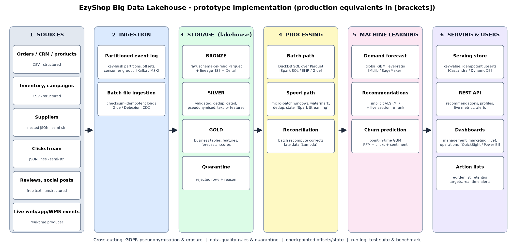

# EzyShop Big Data Prototype: Real-Time Customer and Demand Intelligence Lakehouse

**DAT801A Big Data Architecture and Management, Assessment 3 (Big Data Prototype Solution)**

A working, end-to-end Big Data prototype for the EzyShop business problem defined in
Assessment 2. It ingests structured, semi-structured and unstructured data. It processes data
in **both batch and real time** through a Bronze/Silver/Gold lakehouse. It trains three
production-style ML models and serves insight through a REST API and an interactive
dashboard. Every Assessment 2 target is **measured**, not assumed.



---

## Contents

1. [Introduction](#1-introduction)
2. [Prototype overview](#2-prototype-overview)
3. [Implementation instructions](#3-implementation-instructions)
4. [Interpreting the outputs](#4-interpreting-the-outputs)
5. [Design justification](#5-design-justification)
6. [Testing and refinement](#6-testing-and-refinement)
7. [Conclusion](#7-conclusion)
8. [References](#8-references)
9. [Repository structure](#9-repository-structure)
10. [AI-use disclosure](#10-ai-use-disclosure)

Supporting documents:

- [`docs/01_problem_definition.md`](docs/01_problem_definition.md): Step 1, problem definition.
- [`docs/02_design_plan_technical_brief.md`](docs/02_design_plan_technical_brief.md): Step 2,
  architecture, tool selection and data flow.
- [`docs/03_test_log.md`](docs/03_test_log.md): Step 4, test log of 18 issues and their
  resolutions.
- [`docs/04_video_script.md`](docs/04_video_script.md): Step 5, a 10-minute presentation plan.

---

## 1. Introduction

EzyShop is a growing Australian online retailer selling electronics, apparel and home goods. It
runs on a single-cloud relational database. That system cannot keep up with **~1.5 TB/day of
data (+20 % a year)** or **10,000 transactions per second** at peak. Its data sits in silos
(orders, web logs, reviews, inventory, marketing). The business therefore has no real-time view
of customers. Restocking decisions are slow and personalisation is weak, and EzyShop lost
**12 % of its customers in six months**.

This prototype turns that into a concrete Big Data challenge: *real-time customer-behaviour and
demand intelligence*. It integrates all sources, delivers actionable insight in under five
minutes, and rebuilds churn prediction, personalised recommendations and demand forecasting on
one platform. It does this while protecting personal data (GDPR) and staying cost-efficient.
The full problem definition, mapped to the 5 Vs, is in
[`docs/01_problem_definition.md`](docs/01_problem_definition.md).

## 2. Prototype overview

### 2.1 What it demonstrates (assessment requirements → evidence)

| Requirement (brief, Step 3) | How the prototype demonstrates it |
|---|---|
| Integration of structured and unstructured data | CSV orders/customers/products/inventory/campaigns + nested JSON suppliers + JSON-lines clickstream + free-text reviews and social posts. They are joined in Gold (`product_performance`: sales × review sentiment × top complaint × views; `customer_360`: RFM × sentiment × sessions) and used together by the churn model. |
| Real-time **and** batch processing | Batch: Bronze → Silver → Gold with DuckDB SQL plus nightly-style model training. Real time: 8-partition event log → windowed stream job with watermark, dedup, live stock and alerts. Lambda reconciliation joins the two. |
| Scalable and reliable architecture | Key-hash partitioning; consumer groups; partition-parallel map-reduce, proven equal to the single-process result; columnar Parquet with partition pruning; checkpointed offsets and state; idempotent ingestion and upserts; quarantine instead of failure. |
| Sample datasets to test functionality | Seeded generator with three scale profiles (`tiny`, `small`, `medium`) and deliberately injected data-quality defects. |
| Functional prototype with sample outputs | `outputs/`: KPI scorecard, 7 charts, CSV extracts of every Gold table, reorder list, retention list, real-time alert log, benchmark and data-quality reports. |

### 2.2 Architecture and tools

| Layer | Component (file) | Big Data technique | Production equivalent |
|---|---|---|---|
| Sources | `data_generator.py`, `producer.py` | 8 source feeds in native formats; live simulator with scenarios | Web/app/OLTP/WMS systems |
| Ingestion | `event_log.py`, `bronze.py` | Partitioned append-only log, offsets, consumer groups, idempotent batch loads | Kafka / Amazon MSK, Debezium CDC, Glue |
| Storage | `bronze.py`, `silver.py`, `gold.py` | Medallion lakehouse, Parquet + zstd, Hive partitions, quarantine | S3 + Delta Lake |
| Batch processing | `silver.py`, `gold.py` | Vectorised columnar SQL on Parquet (DuckDB) | Spark SQL on EMR / Glue |
| Stream processing | `streaming.py` | Event-time windows, watermark, dedup, stateful operators, checkpointing, event-time-aligned polling, Lambda reconciliation | Spark Structured Streaming (`scale_out/`) |
| Text analytics | `text_analytics.py` | Sentiment with negation and intensifiers, aspect and category extraction, in batch and in-stream | Spark NLP / SageMaker |
| ML | `ml/forecast.py`, `ml/recommender.py`, `ml/churn.py` | Global GBM forecaster, implicit ALS, point-in-time churn GBM | Spark MLlib / SageMaker |
| Serving | `serving_store.py`, `api.py` | Key-value serving store, idempotent upserts, REST API | Cassandra / DynamoDB, API Gateway |
| Visualisation | `dashboard/app.py`, `report.py` | Role-based dashboards with a live auto-refreshing page | QuickSight / Power BI |
| Governance | `privacy.py`, `silver.py` | HMAC pseudonymisation, data minimisation, right-to-erasure, quality rules | Lake Formation, KMS |

### 2.3 Results from the default run (`small` scale)

| Assessment 2 requirement | Target | Prototype result |
|---|---|---|
| Peak throughput | 10,000 events/s | **0.35–0.96 M events/s** on one laptop (35–96× headroom; lower on battery power); parallel map-reduce verified equal to single-process |
| Insight latency | ≤ 5 min | **181 s** worst case for a finalised 1-min window (60 s window + 120 s watermark); p95 produce→process ≈ 3 s |
| Demand-forecast accuracy | ≥ 90 % | **≈ 93 %** (1 − WAPE) on 12 unseen weeks; best baseline 91.3 % |
| Personalisation improvement | +25 % | **≈ +200 %** precision@10 vs a popularity baseline on unseen purchases |
| Churn (12 % loss problem) | identify at-risk customers | ROC-AUC **≈ 0.95**; top-decile lift **4.3×**; drivers: falling sessions, recency |
| Veracity | quality enforced | 3.7 k records quarantined with reasons, 7.7 k duplicates removed |
| GDPR | pseudonymise, erase | No direct identifiers after Bronze; erasure propagates through serving and Silver/Gold rebuilds |
| Storage efficiency | within budget | Raw 168 MB → Bronze Parquet ≈ 17 MB (**≈ 10×** smaller) |

The exact figures for each run are written to `outputs/summary_report.md`. Small differences
between runs are expected (benchmark timing, random event IDs).

## 3. Implementation instructions

### 3.1 System requirements

- Windows 10/11, macOS or Linux; **Python 3.11+** (tested on **Python 3.14**, Windows 11).
- 4 GB RAM minimum (8 GB recommended), ~500 MB free disk at `small` scale.
- No Java, Docker or cloud account is needed for the prototype. Docker is only needed for the
  optional `scale_out/` stack.

### 3.2 Install

```bash
cd ezyshop-bigdata-prototype
python -m venv .venv
# Windows:  .venv\Scripts\activate      macOS/Linux:  source .venv/bin/activate
pip install -r requirements.txt
pip install -e .        # registers the ezyshop package, so `python -m ezyshop...` works from any terminal
```

If you see `No module named 'ezyshop'` (or `'pandas'`), the terminal is using a Python where these two
commands have not been run: activate the virtual environment, or run both commands in that Python.

Dependencies (pinned in `requirements.txt`): pandas, numpy, pyarrow, duckdb, scikit-learn,
streamlit, plotly, matplotlib, pytest.

### 3.3 Run everything (one command)

```bash
python run_all.py                  # default 'small' scale, ~3 minutes
python run_all.py --scale tiny     # quick smoke run, ~50 seconds
python run_all.py --scale medium   # 4x data volume
python run_all.py --fresh          # force regeneration of the source data
python run_all.py --skip-benchmark # skip the 1M-event throughput benchmark
```

> **Note on `tiny` scale.** `tiny` exists to check that everything runs. With only ~30 orders a
> day, weekly sales per sub-category are dominated by random noise, so the forecast scorecard
> shows about 84 % (NOT MET) there. Accuracy figures should be read from the default `small`
> run (≈ 93 %).

The pipeline runs these steps: generate sources → Bronze → Silver → Gold → demand forecast →
inventory plan → recommender → churn → live stream (produce → process → archive → reconcile) →
benchmark → GDPR erasure demo → report. It then prints the KPI scorecard.

### 3.4 Explore the results

```bash
streamlit run dashboard/app.py         # dashboard at http://localhost:8501
python -m pytest -q                    # 15 automated tests
```

```bash
python -m ezyshop.api --port 8000      # REST API
#   GET /health   /alerts   /metrics/live
#   GET /recommendations/<customer_key>?viewed=P00022&k=10
#   GET /customers/<customer_key>
```

### 3.5 Live real-time demo (two terminals)

```bash
python -m ezyshop.streaming --follow --watermark-seconds 30       # terminal A: stream processor
python -m ezyshop.producer --realtime --rate 500 --events 60000    # terminal B: 2 min of live traffic
```

Then open the dashboard → **Live operations**. The page refreshes every 3 seconds. As the
simulated scenarios unfold, alerts appear: a viral product, a burst of negative reviews, a
checkout outage and stock depletion. Stop with `Ctrl+C`; state and offsets are checkpointed, so
a restart resumes where it stopped. Run `python run_all.py` again to reset the stream.

### 3.6 Individual stages

```bash
python -m ezyshop.data_generator --scale small
python -m ezyshop.bronze
python -m ezyshop.silver
python -m ezyshop.gold
python -m ezyshop.producer --events 40000
python -m ezyshop.streaming --reconcile
python -m ezyshop.benchmark --events 1000000
```

Configuration lives in `src/ezyshop/config.py`. The environment variables `EZYSHOP_SCALE`,
`EZYSHOP_DATA_DIR`, `EZYSHOP_OUTPUT_DIR` and `EZYSHOP_PII_SALT` override the defaults. **Set
`EZYSHOP_PII_SALT` to a secret value outside a demo.**

## 4. Interpreting the outputs

| Output | What it tells you / who uses it |
|---|---|
| `outputs/summary_report.md` | KPI scorecard against each Assessment 2 target (MET / NOT MET), streaming statistics, step timings. **Management.** |
| `outputs/charts/01_weekly_revenue.png` | Revenue trend by category; Black Friday, Christmas, Boxing Day and EOFY peaks. |
| `outputs/charts/02_demand_forecast.png` | Dashed line: forecasts for weeks the model never saw (accuracy in the legend). Orange: the next 6 weeks, including the Black Friday 2026 surge. **Operations.** |
| `outputs/reorder_list.csv` | Products whose stock position ≤ forecast-based reorder point, with suggested order quantity. **Operations.** |
| `outputs/charts/03_recommender_eval.png` | Personalised vs popularity recommendations on purchases made after the training cut-off. |
| `outputs/charts/04_churn.png`, `retention_campaign_targets.csv` | Churn-risk distribution, the main drivers, and the high-risk/high-value customers for a win-back campaign. **Marketing.** |
| `outputs/charts/05_streaming.png`, `realtime_alerts.csv` | Per-minute revenue and cart abandonment, with alert moments (orange lines). The outage is visible as the abandonment spike. **Marketing / operations.** |
| `outputs/charts/06_benchmark.png`, `benchmark_results.json` | Throughput of each processing strategy against the 10 k events/s target. |
| `outputs/charts/07_data_quality.png`, `data_quality_report.json` | Records quarantined or de-duplicated per rule (veracity), and sentiment validated against star ratings. |
| `outputs/gold_samples/*.csv` | The first 500 rows of every Gold table, for inspection without Python. |
| `data/lakehouse/silver/_quarantine/` | Every rejected record with its `_reject_reason`, for data stewards. |

Accuracy definitions:

- **Forecast accuracy** = 1 − WAPE = 1 − Σ|actual − forecast| / Σ actual, computed over all
  sub-category weeks in the holdout.
- **precision@10** = the share of the 10 recommended items the customer actually bought in the
  test window.
- **ROC-AUC** = the probability that a random churner is ranked above a random non-churner.

## 5. Design justification

[`docs/02_design_plan_technical_brief.md`](docs/02_design_plan_technical_brief.md) gives the
full tool-by-tool justification and the alternatives considered. The key decisions are:

1. **Runnable stand-ins with production semantics.** The prototype must be runnable by an
   assessor without a JVM or cluster, so each production technology is replaced by a
   lightweight component with the *same behaviour*:
   - a partitioned log with offsets and consumer groups instead of Kafka;
   - Parquet + DuckDB instead of S3 + Spark SQL;
   - micro-batch windows with watermarks instead of Spark Structured Streaming;
   - a WAL-mode key-value table instead of Cassandra/DynamoDB.

   The code is written against these abstractions, and `scale_out/` shows the Kafka and Spark
   versions of the key jobs.
2. **Lakehouse + medallion.** This keeps the cheap, open storage of a data lake while adding
   the quality and structure of a warehouse (Armbrust et al., 2021). Immutable Bronze means any
   rule change can be re-applied by replaying.
3. **Lambda, with one code path.** The speed layer meets the 5-minute requirement. Batch
   recomputation makes results complete despite late data (Marz & Warren, 2015). Both paths
   call the same `aggregate_events` function, which avoids the "two codebases" problem raised
   by Kreps (2014).
4. **Event time, not processing time.** Watermarks, de-duplication and event-time alignment
   (Akidau et al., 2015) gave correct results under duplicates, late events and partition skew.
   Testing showed every simpler approach failing (test log T-06, T-07, T-11, T-16).
5. **Measured value.** Every model is compared against a simple baseline on data it never saw.
   This follows Assessment 2's principle that targets must be "checked rather than promised".
6. **Privacy by design.** Pseudonymisation and minimisation happen at the Bronze → Silver
   boundary, so no downstream table or model ever sees a direct identifier.

## 6. Testing and refinement

The full log is in [`docs/03_test_log.md`](docs/03_test_log.md). It records 18 issues found
during testing (errors, accuracy problems, bottlenecks) with before/after measurements. The
most significant are:

- **Watermark correctness.** Lambda reconciliation exposed that multi-topic and multi-partition
  skew made the stream drop valid events. The fix combined a min-policy monotonic watermark
  with event-time-aligned polling, as in Flink's watermark alignment. Revenue completeness rose
  from 85.8 % to 99.4 %, and every remaining difference is an intentionally late event,
  recovered exactly by the batch path.
- **Performance.** Profiling showed de-duplication was O(state) per batch. Fixing it raised
  stream throughput 3.6× (12 k → 43 k events/s). The benchmark identified JSON parsing as the
  bottleneck, and a native columnar engine reached 0.35–0.96 M events/s (lower on battery power).
- **Model value.** The first forecaster met 90 % but did not beat a naive baseline. A
  campaign-aware, level-normalised model reached about 93 %.

There are 15 automated tests (`python -m pytest -q`); all pass.

## 7. Conclusion

**Expected outcomes.** The prototype shows the proposed architecture can solve EzyShop's
problem:

- It unifies all five data domains, including unstructured text.
- It produces actionable real-time alerts well inside the 5-minute window.
- It forecasts demand above the 90 % target and drives a reorder plan.
- It identifies at-risk customers with high precision.
- It roughly triples recommendation precision over the non-personalised baseline.
- It shows 35–96× throughput headroom over the 10 k TPS requirement.

On EzyShop's real data, the expected business outcomes are fewer stock-outs before peaks such as
Black Friday, earlier retention action for the 12 % churn problem, higher conversion from
personalisation, and faster response to product or checkout incidents.

**Limitations.**

- The data is synthetic, so accuracy figures are upper-bound indications.
- Throughput was measured on one machine, not a cluster.
- Lexicon sentiment is weaker on real, sarcastic or multilingual text.
- The `scale_out/` Kafka/Spark code was not executed in this environment.

**Potential improvements.**

1. Deploy on Amazon MSK + EMR/Glue + S3/Delta Lake and run the Assessment 2 load test (10 k TPS,
   ≤ 5 min latency) with cost tracking against the AUD 125 k/month cap.
2. Use Delta Lake for ACID MERGE (upserts and GDPR deletes in place) and time travel.
3. Replace lexicon sentiment with a fine-tuned transformer; add topic modelling of complaints.
4. Add a feature store and MLflow model registry with drift monitoring, plus weekly retraining
   (as Assessment 2 proposes).
5. A/B-test recommendations live; use a contextual bandit for real-time personalisation.
6. Use Avro/Protobuf with a schema registry. JSON parsing was measured as the main bottleneck.
7. Feed the forecast into automated purchase orders with supplier lead-time risk.

## 8. References

Akidau, T., Bradshaw, R., Chambers, C., Chernyak, S., Fernández-Moctezuma, R. J., Lax, R., McVeety, S., Mills, D., Perry, F., Schmidt, E., & Whittle, S. (2015). The dataflow model: A practical approach to balancing correctness, latency, and cost in massive-scale, unbounded, out-of-order data processing. *Proceedings of the VLDB Endowment, 8*(12), 1792–1803. https://doi.org/10.14778/2824032.2824076

Apache Software Foundation. (n.d.). *Apache Parquet documentation*. https://parquet.apache.org/docs/

Apache Software Foundation. (n.d.). *Watermark alignment* [Apache Flink documentation]. https://nightlies.apache.org/flink/flink-docs-stable/docs/dev/datastream/event-time/generating_watermarks/

Armbrust, M., Das, T., Torres, J., Yavuz, B., Zhu, S., Xin, R., Ghodsi, A., Stoica, I., & Zaharia, M. (2018). Structured streaming: A declarative API for real-time applications in Apache Spark. In *Proceedings of the 2018 International Conference on Management of Data (SIGMOD '18)* (pp. 601–613). ACM. https://doi.org/10.1145/3183713.3190664

Armbrust, M., Ghodsi, A., Xin, R., & Zaharia, M. (2021). Lakehouse: A new generation of open platforms that unify data warehousing and advanced analytics. In *Proceedings of the 11th Conference on Innovative Data Systems Research (CIDR '21)*. http://cidrdb.org/cidr2021/papers/cidr2021_paper17.pdf

European Parliament and Council of the European Union. (2016). Regulation (EU) 2016/679 (General Data Protection Regulation). *Official Journal of the European Union, L 119*, 1–88. https://eur-lex.europa.eu/eli/reg/2016/679/oj

Gandomi, A., & Haider, M. (2015). Beyond the hype: Big data concepts, methods, and analytics. *International Journal of Information Management, 35*(2), 137–144. https://doi.org/10.1016/j.ijinfomgt.2014.10.007

Hu, Y., Koren, Y., & Volinsky, C. (2008). Collaborative filtering for implicit feedback datasets. In *2008 Eighth IEEE International Conference on Data Mining* (pp. 263–272). IEEE. https://doi.org/10.1109/ICDM.2008.22

Hutto, C. J., & Gilbert, E. (2014). VADER: A parsimonious rule-based model for sentiment analysis of social media text. In *Proceedings of the International AAAI Conference on Web and Social Media, 8*(1), 216–225. https://doi.org/10.1609/icwsm.v8i1.14550

Hyndman, R. J., & Athanasopoulos, G. (2021). *Forecasting: Principles and practice* (3rd ed.). OTexts. https://otexts.com/fpp3/

Irti, C. (2021). Personal data, non-personal data, anonymised data, pseudonymised data, de-identified data. In *Privacy and data protection in software services* (pp. 49–57). Springer Singapore.

Kleppmann, M. (2017). *Designing data-intensive applications: The big ideas behind reliable, scalable, and maintainable systems*. O'Reilly Media.

Koren, Y., Bell, R., & Volinsky, C. (2009). Matrix factorization techniques for recommender systems. *Computer, 42*(8), 30–37. https://doi.org/10.1109/MC.2009.263

Kreps, J. (2014, July 2). *Questioning the Lambda architecture*. O'Reilly Radar. https://www.oreilly.com/radar/questioning-the-lambda-architecture/

Kreps, J., Narkhede, N., & Rao, J. (2011). Kafka: A distributed messaging system for log processing. In *Proceedings of the NetDB Workshop* (pp. 1–7).

Lakshman, A., & Malik, P. (2010). Cassandra: A decentralized structured storage system. *ACM SIGOPS Operating Systems Review, 44*(2), 35–40. https://doi.org/10.1145/1773912.1773922

Marz, N., & Warren, J. (2015). *Big data: Principles and best practices of scalable real-time data systems*. Manning.

Pedregosa, F., Varoquaux, G., Gramfort, A., Michel, V., Thirion, B., Grisel, O., Blondel, M., Prettenhofer, P., Weiss, R., Dubourg, V., Vanderplas, J., Passos, A., Cournapeau, D., Brucher, M., Perrot, M., & Duchesnay, É. (2011). Scikit-learn: Machine learning in Python. *Journal of Machine Learning Research, 12*, 2825–2830.

Raasveldt, M., & Mühleisen, H. (2019). DuckDB: An embeddable analytical database. In *Proceedings of the 2019 International Conference on Management of Data (SIGMOD '19)* (pp. 1981–1984). ACM. https://doi.org/10.1145/3299869.3320212

Taylor, S. J., & Letham, B. (2018). Forecasting at scale. *The American Statistician, 72*(1), 37–45. https://doi.org/10.1080/00031305.2017.1380080

Zaharia, M., Xin, R. S., Wendell, P., Das, T., Armbrust, M., Dave, A., Meng, X., Rosen, J., Venkataraman, S., Franklin, M. J., Ghodsi, A., Gonzalez, J., Shenker, S., & Stoica, I. (2016). Apache Spark: A unified engine for big data processing. *Communications of the ACM, 59*(11), 56–65. https://doi.org/10.1145/2934664

## 9. Repository structure

```
ezyshop-bigdata-prototype/
├── run_all.py                 # one-command end-to-end pipeline
├── requirements.txt
├── src/ezyshop/
│   ├── config.py              # paths, scale profiles, targets
│   ├── data_generator.py      # 8 synthetic source systems + injected defects
│   ├── producer.py            # live event simulator (scenarios, duplicates, late data)
│   ├── event_log.py           # partitioned log, consumer groups, aligned polling
│   ├── bronze.py              # raw landing, lineage, idempotency, stream archiver
│   ├── silver.py              # validation, quarantine, dedup, conforming, pseudonymisation
│   ├── text_analytics.py      # sentiment, aspects, category detection
│   ├── gold.py                # DuckDB SQL business tables
│   ├── streaming.py           # speed layer + Lambda reconciliation
│   ├── ml/forecast.py         # demand forecast + inventory reorder plan
│   ├── ml/recommender.py      # implicit ALS + evaluation
│   ├── ml/churn.py            # point-in-time churn model
│   ├── serving_store.py       # key-value serving store
│   ├── api.py                 # REST API
│   ├── privacy.py             # GDPR pseudonymisation and erasure
│   ├── benchmark.py           # throughput benchmark
│   └── report.py              # scorecard, charts, CSV extracts
├── dashboard/app.py           # Streamlit dashboard (6 stakeholder views)
├── tests/                     # pytest unit + integration tests
├── scale_out/                 # Kafka + Spark reference jobs (docker-compose)
├── docs/                      # problem definition, technical brief, test log, video plan, diagram
└── outputs/                   # sample outputs from the default run
```

`data/` (≈ 200 MB) is generated by `run_all.py` and is not included in the submission archive.
Any reviewer can regenerate it with the same seed.

## 10. AI-use disclosure

The assessment permits authorised AI use. An AI coding assistant (Claude) was used to help write
and debug the prototype code and draft the documentation. **Before submission, the student must**:

- review and understand all code and text, and be able to explain it in the video;
- edit the documentation into their own words where required;
- complete and sign the ICMS AI Declaration form, describing this use.
