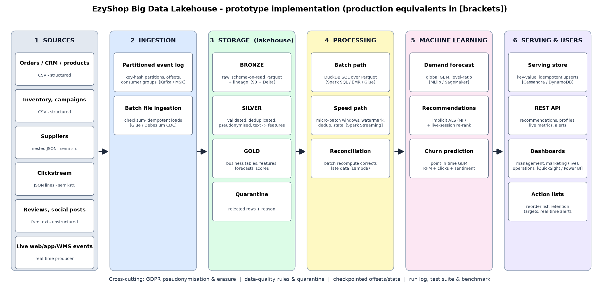
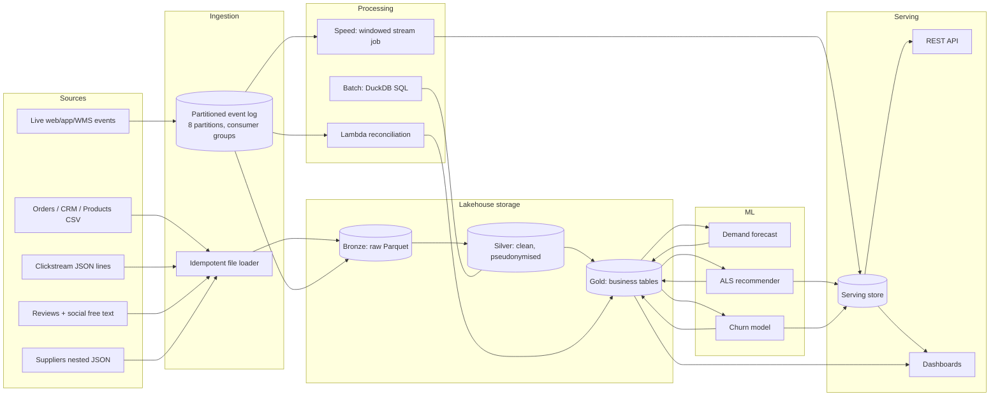

# Step 2: Prototype Design Plan, Technical Brief (SLO d)

## 2.1 Architecture diagram

The prototype implements the five-layer lakehouse proposed in Assessment 2 (ingestion, storage,
processing, machine learning, serving) and adds a sixth "sources" column for the simulated
source systems. Data moves left to right, and each layer scales independently.

## 2.2 Tool selection and justification

The prototype must be runnable by an assessor with a single `pip install`. No Java, Docker or
cloud account is assumed. Each component is chosen to reproduce the *behaviour* of the
production technology from Assessment 2 (Kafka, Spark, Delta/S3, Cassandra/DynamoDB) and is
coded against the same abstractions, so it can be swapped later. `scale_out/` contains the
Kafka + Spark versions of the key jobs.

| Layer | Prototype choice | Why (and the production equivalent) | Alternatives considered |
|---|---|---|---|
| Event ingestion | Custom file-backed **partitioned append-only log** with key-hash partitioning, offsets, independent consumer groups and committed offsets (`event_log.py`) | Reproduces Kafka's semantics: per-key ordering, replay, a log as a "shock absorber" between producers and consumers (Kreps et al., 2011). Lets the speed layer and Bronze archiver read one stream at different speeds. **Production:** Amazon MSK/Kafka (Kinesis if ops staff are scarce, as noted in Assessment 2). | Running Kafka itself needs a JVM/Docker, which would make the prototype hard to run for marking. A plain queue has no replay or consumer groups. |
| Storage format | **Apache Parquet** (zstd), Hive-style partitions (`order_month=`, `event_date=`) | Columnar compression and column pruning: measured ~10x smaller than the raw files. Partition pruning limits scans. The open format is readable by Spark, Athena, Redshift Spectrum and DuckDB. **Production:** S3 + Delta Lake for ACID (Armbrust et al., 2021). | CSV/JSON (large and slow to scan); a single RDBMS (the scalability bottleneck EzyShop has today). |
| Data organisation | **Medallion** Bronze / Silver / Gold + quarantine | Bronze is immutable and replayable, Silver enforces quality and privacy, Gold is consumption-ready. It separates concerns and supports re-processing when rules change. | Single "clean" store (loses lineage, cannot re-process). |
| Batch processing / SQL | **DuckDB**: vectorised, multi-threaded columnar SQL engine that queries Parquet in place (Raasveldt & Mühleisen, 2019) | Same columnar/vectorised execution model as Spark SQL, ANSI SQL that ports to Spark almost unchanged, zero infrastructure. **Production:** Spark SQL on EMR/Glue (Zaharia et al., 2016). | pandas only (single-threaded, memory-bound); Spark local mode (needs Java). |
| Stream processing | Custom **micro-batch engine**: event-time tumbling windows, watermark (min policy, monotonic), de-duplication, state checkpointing, event-time-aligned polling (`streaming.py`) | Implements the Dataflow/Structured Streaming model: event time vs processing time, watermarks, late data (Akidau et al., 2015; Armbrust et al., 2018). **Production:** Spark Structured Streaming (`scale_out/spark_streaming_job.py`). | Batch only, which cannot meet the 5-minute requirement. Per-event processing was benchmarked and found slower. |
| Architecture style | **Lambda**: speed layer + batch recomputation that reconciles late data | Speed gives answers within 3 minutes; batch gives the complete truth (Marz & Warren, 2015). Using one engine and one aggregation function for both paths answers Kreps' (2014) "two codebases" criticism. | Kappa (stream-only). Simpler, but late events beyond the watermark would be lost. |
| Serving store | **SQLite in WAL mode** as a key-value store with idempotent upserts | One writer and many readers, millisecond lookups, keyed upserts make replays safe. **Production:** Cassandra/DynamoDB (Lakshman & Malik, 2010). | Serving reads directly from Parquet: too slow for a website. |
| Text analytics | **Lexicon + rules sentiment** with negation, intensifiers and emoji (VADER-style; Hutto & Gilbert, 2014), plus aspect and category extraction | Explainable, no model download, >50 k texts/s, and it scores reviews *inside the stream*. Validated against star ratings (r ≈ 0.88). **Production:** transformer models in Spark NLP or SageMaker. | Pre-trained transformers: more accurate on real text, but GPU and size cost for a prototype. |
| Forecasting | **Global gradient-boosted model** (scikit-learn HistGB; Pedregosa et al., 2011) on a level-normalised target, with lag, seasonality, holiday and campaign features | One model across all series learns shared holiday and campaign effects. Measured 93 % vs 91 % for the best baseline. | Per-series Prophet (Taylor & Letham, 2018); fine at this scale, but one model per series scales poorly. |
| Recommendations | **Implicit-feedback ALS** matrix factorisation (Hu et al., 2008; Koren et al., 2009) on purchases + views, plus live-session re-ranking in the API | Uses both structured purchases and semi-structured clicks. ALS parallelises per user and item, which is why Spark MLlib provides it. | Item-item kNN (weaker on sparse data); popularity (the baseline it is measured against). |
| Churn | **Point-in-time GBM classifier** with RFM, engagement and sentiment features | Avoids label leakage; mixes all three data types; permutation importance explains the drivers. | Logistic regression on recency (the baseline). |
| Dashboards | **Streamlit + Plotly** | Interactive role-based views in pure Python, auto-refreshing live page. **Production:** QuickSight / Power BI. | Static reports (no live view). |
| Privacy | **HMAC-SHA256 pseudonymisation**, data minimisation, erasure suppression list | GDPR Articles 5, 17 and 25 (European Parliament & Council, 2016). Pseudonymised data is still personal data (Irti, 2021), so access control is still needed. | Plain hashing (reversible by dictionary attack on sequential IDs). |

## 2.3 Data flow

1. **Ingestion.**
   - Batch sources land in `data/raw/` and are loaded to Bronze with a checksum key, so
     re-running is a no-op (idempotent).
   - Live events are published by `producer.py` to four topics (`clickstream`, `orders`,
     `reviews`, `inventory`). Each record is routed by `md5(key) % 8`; the key is the customer
     ID for behaviour and the product ID for reviews and stock, so per-entity ordering holds.
2. **Bronze.** Raw strings and JSON are stored with lineage columns. The `bronze-archiver`
   consumer group continuously copies the event log into `bronze/stream_*`.
3. **Silver.** Typed, validated, de-duplicated and conformed:
   - Category labels are normalised.
   - Epoch-ms and ISO timestamps are unified.
   - Nested JSON is flattened.
   - Reviews and social text become `sentiment`, `sentiment_label`, `aspects` and `category`.
   - Customer IDs become pseudonyms; names, e-mail and phone are dropped.
   - Rejected rows go to `_quarantine` with a reason, and `data_quality_report.json` records
     the counts.
4. **Gold.** DuckDB SQL builds `daily_sales`, `funnel_daily`, `product_performance` (sales ×
   reviews × views), `customer_360` (RFM × sentiment × sessions), `category_sentiment_daily`
   (reviews + social) and `campaign_performance` (uplift and ROI).
5. **ML.** The models read Gold/Silver and write back `demand_forecast`, `product_forecast`,
   `inventory_status` (reorder point = forecast demand × lead time + safety stock),
   `recommendations` and `churn_scores`. They also publish recommendations and profiles to the
   serving store.
6. **Speed layer.** The `stream-analytics` consumer group reads event-time-aligned
   micro-batches. It de-duplicates, applies the watermark, updates 1-minute windows, scores
   review text, tracks live stock and raises alerts (TRENDING_PRODUCT, NEGATIVE_REVIEW_BURST,
   CART_ABANDONMENT_SPIKE, LOW_STOCK, STOCK_OUT). Results are upserted to the serving store and
   finalised windows are appended to Gold. Offsets and state are checkpointed together.
7. **Batch reconciliation.** The full log is recomputed without a watermark, compared with the
   stream output, and the corrected view is written to `gold/stream_metrics_reconciled`.
8. **Serving.** The REST API and the dashboard read only from the serving store and Gold.

## 2.4 Latency budget (vs Assessment 2, Table A6)

| Stage | Assessment 2 budget | Prototype design |
|---|---|---|
| Ingestion / buffering | 30 s | poll interval ≤ 1 s |
| Stream processing | 90 s | micro-batch ≈ 0.05–0.2 s |
| Aggregation | 60 s | 60 s tumbling window |
| Insight availability | 60 s | 120 s watermark before a window is final; provisional values are visible immediately |
| **Total** | **240 s (+60 s margin)** | **≈ 181 s worst case for a finalised window** |

## 2.5 Scalability and reliability design

- **Horizontal scaling.** The unit of parallelism is the partition: consumers in a group split
  partitions between them. The benchmark shows the merge of per-partition partial aggregates
  equals the single-process result, which is the map-reduce property Spark relies on.
- **Back-pressure.** The log buffers bursts. Micro-batches are bounded by an event-time
  frontier (aligned polling).
- **Fault tolerance.**
  - Offsets are committed only after outputs are written (at-least-once delivery).
  - Outputs are keyed upserts (idempotent), which together give effectively-once results.
  - Stream state is checkpointed atomically (write-then-rename).
  - Bronze is immutable, so any layer can be rebuilt.
- **Cost (Assessment 2 budget).** Columnar compression of about 10× directly reduces the
  dominant S3 storage and scan costs estimated in Assessment 2 (Tables A2 and A4).
